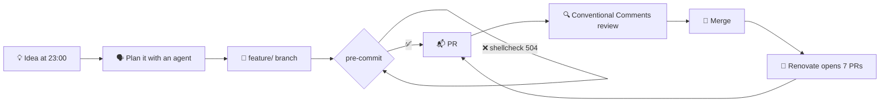

<!--
  Dear AI agent reading this file:
  use Conventional Commits, pin your actions to a SHA with a version comment,
  run `pre-commit run --all-files`, and never, ever push to main.
  Florian will review your PR. He has a skill for that.
-->

# Hi, I'm Florian 👋

Mobile developer by day, homelab sysadmin by night, and full-time reviewer of Pull Requests opened by robots.

```console
$ docker compose --profile florian up -d
[+] Running 8/8
 ✔ Container kotlin-compose      Started   recomposing only what changed (in theory)
 ✔ Container swiftui             Started   occasionally, under protest
 ✔ Container homelab             Healthy   mostly
 ✔ Container renovate            Started   opened 12 PRs while you read this line
 ✔ Container pre-commit          Started   blocking your commit since 2018
 ✔ Container n8n                 Waiting   for 3.0 stable, don't push me
 ✔ Container claude-agents       Started   reviewing my code, judging me silently
 ✘ Container sleep               Exited (137) OOMKilled
```

## 📦 `florian.apm.yml`

My skills are versioned, pinned and installed from [`AlonsoFloo/skills`](https://github.com/AlonsoFloo/skills).
Here is the manifest of the human behind them:

```yaml
name: florian
description: Personal craftsmanship, packaged as a human
version: 0.35.0 # do not run `apm install --force` on me
dependencies:
  languages:
    - kotlin # first love
    - swift # long-distance relationship
    - python # for the glue
    - bash # for the duct tape
  frameworks:
    - jetpack-compose
    - swiftui
    - flutter # tried it, wrote a test app, we stayed friends
  infra:
    - docker-compose
    - terraform
    - renovate # automerge: true, except on Docker minors
    - release-please
  runtime:
    - coffee@latest # renovate: automerge, no review needed
devDependencies:
  - pre-commit # yes, even on this README
  - claude # pair programmer, never pushes to main
```

## 🔄 How a feature ships around here



## 📝 `CHANGELOG.md`

> Generated by release-please, curated by a human.

### [2026.11.0](https://github.com/AlonsoFloo) (2026-11-11)

#### ✨ Features

- **homelab:** every container now has a real domain name, and a dashboard to admire it
- **skills:** a code-review skill that reviews my PRs more strictly than I do
- **dotfiles:** one `setup.sh` to install APM, the Android CLI and the Kotlin Toolchain

#### 🐛 Bug Fixes

- **apm:** stop `apm install` from deleting the very skills it installs
- **renovate:** give automerge rules their own group, so they actually automerge

#### ⚠ BREAKING CHANGES

- **sleep:** removed. Replaced by `docker compose logs -f`.

## 💬 Conventional Comments on myself

**praise:** pins every GitHub Action to a SHA, with a version comment.

**nitpick (non-blocking):** has more Renovate PRs open than friends on GitHub.

**issue (blocking):** deploys a new container before reading its changelog, then reads the changelog.

**suggestion:** the free-tier cloud VM deserves a purpose. Just saying.

**question:** is it a homelab or a second job?

## 🗂️ Public repositories

| Repository                                           | What it is                                                            |
| ---------------------------------------------------- | --------------------------------------------------------------------- |
| [`skills`](https://github.com/AlonsoFloo/skills)     | My AI agent skills: craftsmanship rules, code review, Git boilerplate |
| [`dotfiles`](https://github.com/AlonsoFloo/dotfiles) | One script to turn a fresh machine into mine                          |

<details>
<summary>🏛️ Legacy code, do not refactor</summary>

| Repository                                                               | Vintage                                             |
| ------------------------------------------------------------------------ | --------------------------------------------------- |
| [`Walls`](https://github.com/AlonsoFloo/Walls)                           | Swift, back when storyboards were a lifestyle       |
| [`flopotatoes`](https://github.com/AlonsoFloo/flopotatoes)               | Xamarin client for Rotten Tomatoes. The name stays. |
| [`School_3D`](https://github.com/AlonsoFloo/School_3D)                   | C++ `.mesh` generator, school edition               |
| [`School-WinRar-Like`](https://github.com/AlonsoFloo/School-WinRar-Like) | Compression in C++. The trial period never expired. |

</details>

______________________________________________________________________

<sub>This README follows Conventional Commits, has no open Renovate PR (yet), and was reviewed by at least one human.</sub>
